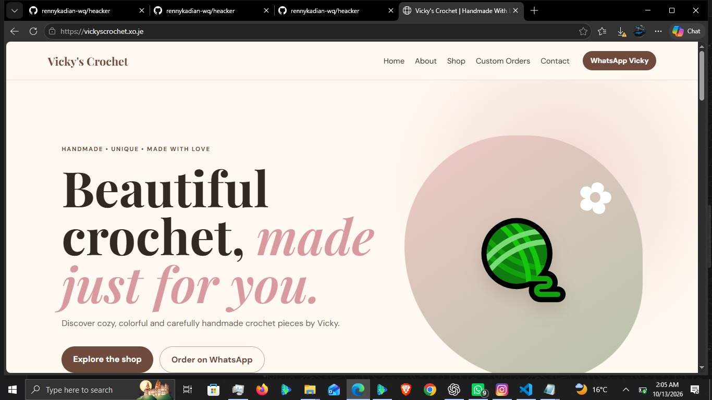

# Renny Keith | Software Engineering Portfolio 💻

Welcome to my portfolio! I'm a Software Engineering student at Zetech University, passionate about building useful websites and software applications.

## 🛠️ Skills

* HTML & CSS
* JavaScript
* PHP
* MySQL
* Git & GitHub
* Visual Studio Code

## 🚀 Featured Project: Vicky's Crochet

A website showcasing crochet products, including handmade bags, plushies, flowers, and other creative items.

**Live Website:** https://vickyscrochet.xo.je

### Website Screenshots

**Homepage**

**More Website Views**

### Technologies Used

* PHP
* HTML
* CSS
* JavaScript
* MySQL

## 🎓 Education

**Zetech University** — Software Engineering

## 🎯 Career Goal

To grow as a software developer by building practical projects, improving my coding skills, and contributing to real-world software solutions.

## 📫 Connect With Me

* **GitHub:** https://github.com/rennykadian-wq
